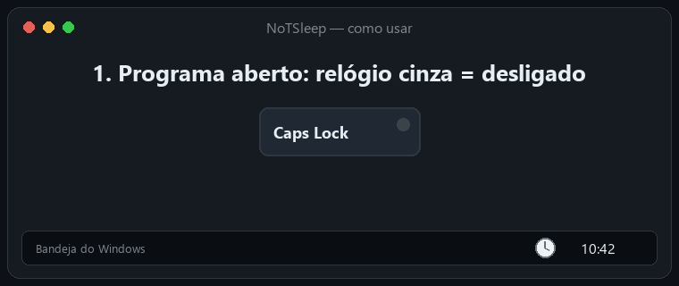
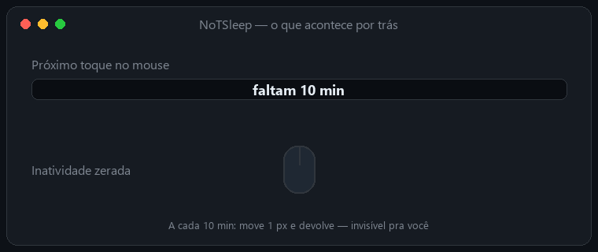
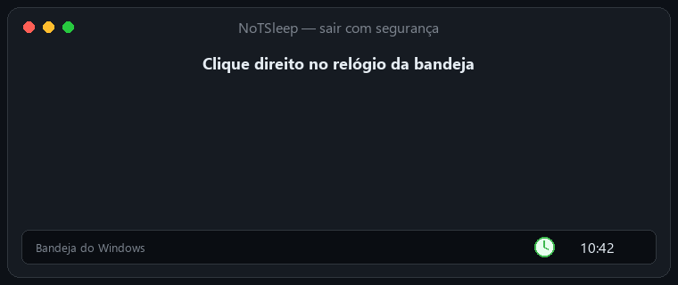

<div align="center">

# 🕐 NoTSleep

### Caps Lock ligado = PC acordado. Caps Lock desligado = tudo normal.




</div>

---

## ✨ O que ele faz

| | Recurso | Detalhe |
|---|---|---|
| 🟢 | **Liga com o Caps Lock** | Relógio verde na bandeja = ativo |
| 🖱️ | **Move o mouse 1 pixel** | A cada **10 minutos**, e devolve na hora |
| 💻 | **Tampa fechada** | Tenta mudar a ação para *Não fazer nada* (bateria e carregador) |
| ♻️ | **Restaura tudo** | Ao desligar o Caps Lock ou sair, volta à configuração anterior |
| 🔒 | **Local e privado** | Não usa internet, não coleta nada, não envia nada |

---

## 🚀 Como usar

### 1️⃣ Abra o programa
Ele fica quietinho ao lado do relógio. O ícone **cinza** 🩶 significa *desligado*.

### 2️⃣ Aperte **Caps Lock**
O ícone vira **verde** 💚 e aparece um aviso. Pronto: o PC não bloqueia por inatividade.

<div align="center">

</div>

### 3️⃣ Entenda o que acontece por trás

<div align="center">

</div>

### 4️⃣ Saia com segurança
Clique com o botão direito no relógio → **Sair e restaurar energia**.

<div align="center">

</div>

> [!NOTE]
> Os GIFs acima são **ilustrações animadas** do fluxo de uso, não gravações reais da tela.

---

## ⚠️ Limites importantes

> [!WARNING]
> O NoTSleep **não tenta burlar política corporativa**. Se a política da empresa proibir a alteração da ação da tampa, o ícone ao lado do relógio exibirá um aviso. Mesmo assim, o movimento do mouse continuará renovando o tempo de inatividade.

> [!TIP]
> Esqueceu o Caps Lock ligado? Sem problema: é só apertar de novo, ou usar **Sair e restaurar energia** no menu da bandeja.

---

## 🛠️ Para desenvolvedores

**▶️ Executar**

```powershell
dotnet run --project .\NoTSleep\NoTSleep.csproj
```

**🧪 Testar**

```powershell
dotnet run --project .\NoTSleep.Tests\NoTSleep.Tests.csproj
```

**📁 Estrutura**

| Pasta | Para quê |
|---|---|
| `NoTSleep/` | App da bandeja (Windows Forms) |
| `NoTSleep.Core/` | Lógica do Caps Lock, timer e restauração de energia |
| `NoTSleep.Tests/` | Testes |
| `native/` | Versão nativa em C++ (`build-native.ps1`) |
| `docs/` | GIFs usados neste README |

---

<div align="center">

Feito com 💚 por [Roberto Rezende](https://github.com/robertorezendejr)

</div>
